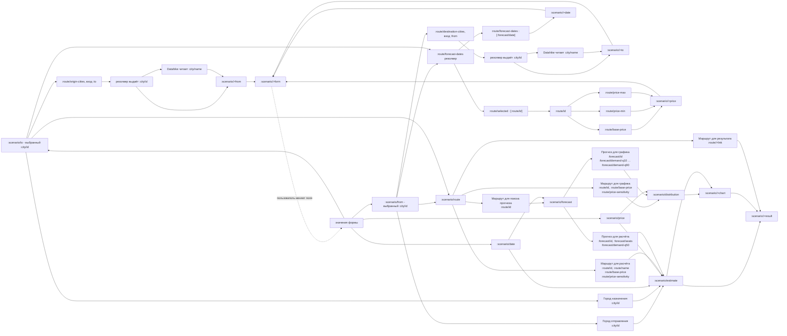
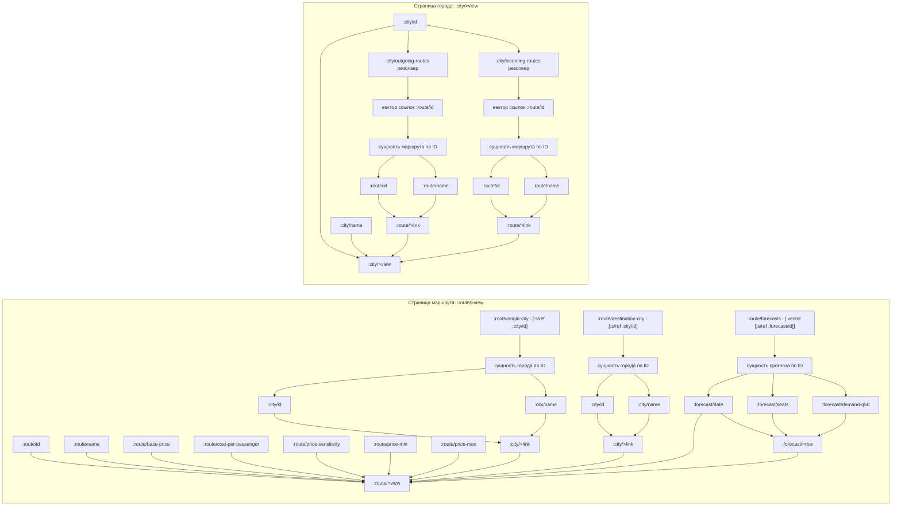

# Решись Авиа

Веб-приложение для оценки спроса и продаж на авиарейсах по заданию «Решись Авиа», блок «Разработка», вариант C. Пользователь выбирает города отправления и назначения, дату вылета и цену билета. Сервер находит прогноз рейса и возвращает число мест, ожидаемые продажи и график спроса.

Демонстрационная версия размещена на [Render](https://reshis-2026-somuthink.onrender.com/). Исходный код опубликован в [GitHub](https://github.com/somuthink/reshis-2026).

## Функции по условиям задания

| Требование | Реализация |
|---|---|
| Веб-страница с серверными расчётами, вариант C | Форма в браузере отправляет запрос через JavaScript-библиотеку Datastar на `POST /eql`. Clojure-сервер выполняет расчёт и возвращает HTML для обновления страницы. |
| Прогноз по маршруту, дате и цене | Выбор строки прогноза из базы и расчёт спроса по медиане с учётом ценовой чувствительности. Продажи ограничены нулём и числом мест. |
| График распределения спроса | Девять квантилей от 0,1 до 0,9 пересчитываются для введённой цены. На графике отмечена вместимость самолёта. |
| Регистрация и авторизация | Страницы `/register` и `/login`, пароли в виде хэшей, сессии и проверка прав на маршруты. |
| Размещение на хостинге | Docker-образ для Render с исходными городами, маршрутами и прогнозами. Ограничения бесплатного размещения описаны ниже. |

Модель машинного обучения не запускается при запросе страницы. Приложение использует готовый результат ML-блока из `my_forecast.csv`; копия для сборки образа хранится в `deploy/my_forecast.csv`. Сведения об ИИ-моделях и инструментах разработки приведены в конце документа.

## Архитектура

В приложении [Scriptorium](https://github.com/somuthink/scriptorium) связывает схемы данных, Pathom-резолверы, Datahike и HTTP. Malli-схема задаёт типы и связи; EQL-запрос описывает нужные ветви графа.

- **[Clojure](https://clojure.org/)** - функциональный Lisp для JVM с неизменяемыми persistent-структурами и REPL.
- **[Malli](https://github.com/metosin/malli)** - схемы как данные Clojure; поддерживает композицию, расширение через registry и пользовательские схемы. Scriptorium собирает их в общий registry и использует для Datahike, Pathom и полей форм.
- **[Pathom 3](https://github.com/wilkerlucio/pathom3) и [EQL](https://github.com/edn-query-language/eql)** - EQL-запросы задают нужные атрибуты и join-ы как EDN. Резолверы объявляют входы и выходы; Pathom строит план вычислений для запрошенного графа. Запросы можно собирать и преобразовывать средствами Clojure; отдельная GraphQL SDL-схема не нужна, но клиенту нужен контракт EQL-атрибутов.
- **[Datahike](https://github.com/replikativ/datahike) и [Datalog](https://en.wikipedia.org/wiki/Datalog)** - база фактов с декларативными запросами: общие переменные связывают условия `:where`, поэтому запрос описывает нужные связи, а не ручной порядок обхода. Приложение ищет маршруты по городам и прогнозы по маршруту и дате. Datahike хранит историю транзакций и поддерживает ветки; здесь используется файловая база, пользовательские ветки не задействованы.
- **[EACL](https://github.com/theronic/eacl)** - ReBAC-модель доступа, вдохновлённая [SpiceDB](https://github.com/authzed/spicedb): отношения «субъект - право - ресурс» хранятся в Datahike, а Pathom проверяет их при выполнении операций. Доступ по умолчанию закрыт.
- **[Hiccup](https://github.com/weavejester/hiccup) и [Chassis](https://github.com/onionpancakes/chassis)** - view-функции возвращают HTML-дерево в виде Clojure-векторов и карт; Chassis сериализует его на сервере.
- **[Datastar](https://data-star.dev/)** - браузер отправляет изменения формы на `/eql`; сервер возвращает SSE с HTML-патчем, который Datastar применяет к DOM. Формы и вычисления остаются на сервере без отдельного SPA-слоя.
- **[Reitit](https://github.com/metosin/reitit) и [Ring](https://github.com/ring-clojure/ring)** - маршруты объявлены данными; Reitit собирает Ring-роутер и подключает EQL endpoint и middleware.
- **[Integrant](https://github.com/weavejester/integrant)** - запускает и останавливает компоненты приложения в заданном порядке.
- **[Babashka](https://babashka.org/) и [`clojure.data.csv`](https://github.com/clojure/data.csv)** - запускают импорт CSV из командной строки и разбирают строки файлов.

## Scriptorium в этом приложении

Scriptorium связывает Malli-схемы с Datahike, вычислениями Pathom и HTML-представлениями. `:in` задаёт зависимости, `:resolve` - функцию расчёта, `:s/ref` - ссылку на сущность. Вложенная выборка EQL задаёт поля связанной сущности.

### Форма и расчёт сценария

Поле формы описывает источник данных и способ отображения. Например, список городов получает идентификаторы и названия из `:route/origin-cities`:

```clojure
[:scenario/from
 {:>label "Откуда"
  :>in [{:route/origin-cities [:city/id :city/name]}]
  :>options {:source :route/origin-cities :value :city/id :label :city/name}}
 [:s/ref :city/id]]
```

Форма запрашивает дату как `(:scenario/>date {:label? false})`: `app.views.fields/date-field` читает параметр через `pco/params` и скрывает видимую подпись, сохраняя доступное имя и ограничения дат. Без параметра подпись отображается. Кнопки «Минимум», «Базовая», «Максимум» используют цены выбранного маршрута, синхронизируют поле и ползунок и запускают обычный пересчёт прогноза. Панель управления занимает высоту содержимого; графику отведена более широкая отдельная панель.

«Подобрать цену» принимает целевые продажи по медиане. Мутация `app.mutations.scenario/set-target-sales` использует параметризованный расчёт `:scenario/target-price` и возвращает новую цену с согласованным прогнозом. Один EQL-запрос выбирает `[:scenario/>price :scenario/>result]`: поле цены и оба графика обновляются одним ответом. Повторные запросы запускаются только действиями пользователя, а не серверным обновлением сигнала. Цели выше вместимости и цены вне диапазона маршрута отклоняются без изменения текущей цены. Это целевой прогноз, не гарантия фактических продаж.

На схеме стрелки ведут от данных к вычислениям и представлениям. Многострочные блоки показывают поля вложенных выборок.



### Вложенные страницы маршрута и города

Обработчик передаёт ID из URL в Pathom. Запрос страницы маршрута включает связанные города и прогнозы:

```clojure
[:route/id :route/name
 {:route/origin-city [:city/>link]}
 {:route/destination-city [:city/>link]}
 {:route/forecasts [:forecast/date :forecast/>row]}]
```

Pathom раскрывает зависимости представлений до полей сущностей. Проверка EACL ограничивает доступ к данным.



Резолверы прилётов и вылетов выбирают маршруты по ID города с учётом прав EACL; функции представления получают готовые вложенные данные.

## Данные и расчёт прогноза

`deploy/my_forecast.csv` содержит 155 записей для пяти маршрутов из Москвы: MOW-AER, MOW-KGD, MOW-LED, MOW-MRV и MOW-OVB. Период - с 1 июня по 1 июля 2026 года включительно. `routes.csv` задаёт города, базовые цены и чувствительность спроса к цене.

Сервер выбирает прогноз по `route` и `date`. Расчёт в `src/app/resolvers/scenario.clj`:

```text
спрос = 0.5_base_demand − price_sensitivity × (цена − base_price)
продажи = min(seats, max(0, спрос))
```

Каждый из девяти квантилей пересчитывается по той же формуле. Медиана графика совпадает со спросом до ограничения числом кресел; вместимость отмечена отдельно. Пересчёт формы выполняется с задержкой 300 мс, отсутствие маршрута или прогноза возвращает ошибку.

`:scenario/>chart` получает распределение и оценку через `:in` и возвращает Hiccup: компактную шкалу центральных 80% прогноза и график вероятности превышения спроса. Обе части используют общую шкалу спроса и отметку вместимости. `:scenario/>result` включает готовое представление графика, крупный прогноз продаж и ссылку на маршрут. SVG обновляется вместе с результатом через Datastar; отдельная браузерная библиотека графиков не нужна. Таблица девяти квантилей доступна программам чтения с экрана.

Пароли хранятся в виде PBKDF2-SHA256-хэшей; права на маршруты проверяются сервером.

## Запуск и данные

Для исходного запуска нужны Java 25, Clojure CLI и Scriptorium по пути `../../scriptorium` относительно приложения.

```sh
clojure -M -m app.main
clojure -T:build uber
java -jar target/reshis-2026.jar
```

| Переменная | Назначение |
|---|---|
| `DATABASE_PATH` | Файловая база, по умолчанию `data/routes-db` |
| `IP`, `PORT` | Адрес и порт сервера, по умолчанию `0.0.0.0` и `3000` |
| `PUBLIC_ORIGIN` | Публичный HTTPS-адрес без пути и завершающего `/`; используется для проверки POST-запросов за прокси |

Импорт Babashka выполняется после создания схемы и остановки приложения:

```sh
bb import_csv.clj
# Либо с явными источниками:
bb import_csv.clj routes.csv forecast.csv
```

Настройки хранятся в `import.edn`; путь прогноза по умолчанию - `../ml/my_forecast.csv`. Повторный импорт добавляет прогнозы, не заменяя прежние записи.

### Docker и Render

```sh
docker build -t reshis .
docker run --rm -p 10000:10000 reshis
```

Образ содержит JAR и базу с импортированными городами, маршрутами и прогнозами из `deploy/my_forecast.csv`. Локальные пользователи и сценарии в образ не попадают.

В Render используются `./Dockerfile`, корневой контекст сборки и проверка доступности `/login`. Платформа задаёт `PORT`; `PUBLIC_ORIGIN` содержит `https://reshis-2026-somuthink.onrender.com`.

Render Free засыпает после 15 минут без запросов и не сохраняет изменения файловой базы при перезапуске. Исходные данные восстанавливаются из образа, новые пользователи и сценарии теряются.

### Проверки

```sh
clojure -M:test -e "(require 'clojure.test 'app.user-test 'app.mutations.user-test 'app.acl-test 'app.resolvers.scenario-test) (let [r (clojure.test/run-tests 'app.user-test 'app.mutations.user-test 'app.acl-test 'app.resolvers.scenario-test)] (System/exit (+ (:fail r) (:error r))))"
bb -cp .:test -e "(require 'import-csv-test) (let [r (clojure.test/run-tests 'import-csv-test)] (System/exit (+ (:fail r) (:error r))))"
```

## Инструменты разработки

- **Редакторы кода**
  - [Sublime Text](https://www.sublimetext.com/) с [Clojure Sublimed](https://github.com/tonsky/Clojure-Sublimed).
  - [Neovim](https://neovim.io/) с [Conjure](https://github.com/Olical/conjure).
- **[Oh My Pi (OMP)](https://github.com/can1357/oh-my-pi)** - среда работы с ИИ-моделями, инструментами и контекстом проекта.
  - [brepl](https://github.com/licht1stein/brepl) - клиент командной строки для [nREPL](https://github.com/nrepl/nrepl) с исправлением скобок в выражениях.
  - [ast-grep](https://github.com/ast-grep/ast-grep) находит синтаксические структуры; ast-edit меняет Clojure-код структурно, без текстовых замен.
  - **ponytail** - набор правил для небольших изменений без лишних абстракций.
- **Модели** - Luna была основной моделью; GPT-6.1-sol использовался как советник.


