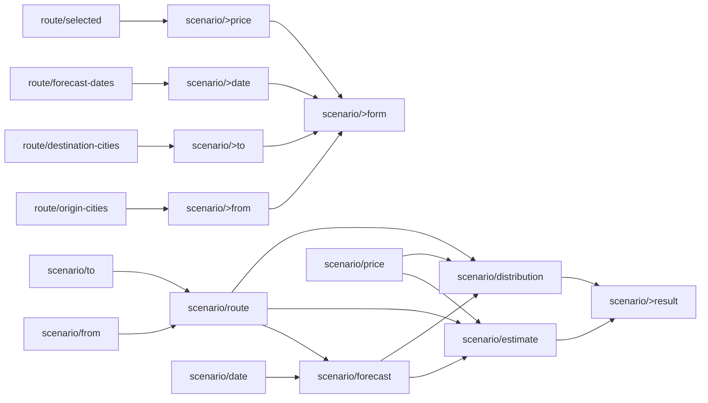
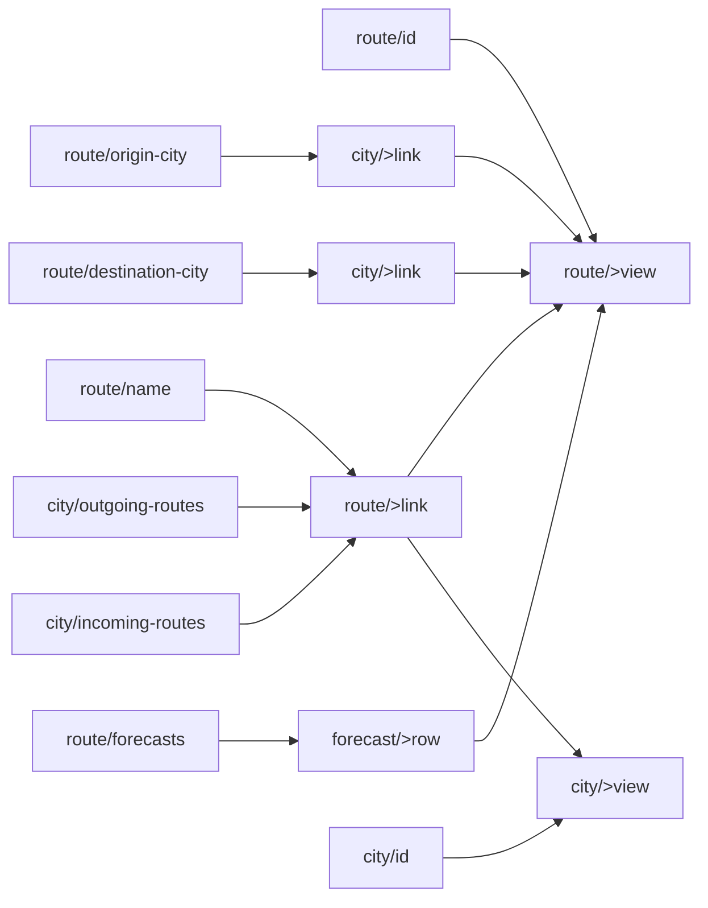

# Решись Авиа

Веб-приложение для оценки спроса и продаж на авиарейсах. Пользователь выбирает маршрут, дату и цену; сервер возвращает прогноз продаж и распределение спроса

## Архитектура

В приложении [Scriptorium](https://github.com/somuthink/scriptorium) связывает схемы данных, Pathom-резолверы, Datahike и HTTP. Malli-схема задаёт типы и связи; EQL-запрос описывает нужные ветви графа.

- **[Clojure](https://clojure.org/)** - функциональный Lisp для JVM с неизменяемыми persistent-структурами и REPL.
- **[Malli](https://github.com/metosin/malli)** - схемы как данные Clojure; поддерживает композицию, расширение через registry и пользовательские схемы. Scriptorium собирает их в общий registry и использует для Datahike, Pathom и полей форм.
- **[Pathom 3](https://github.com/wilkerlucio/pathom3) и [EQL](https://github.com/edn-query-language/eql)** - EQL-запросы задают нужные атрибуты и join-ы как EDN. Резолверы объявляют входы и выходы; Pathom строит план вычислений для запрошенного графа. Запросы можно собирать и преобразовывать средствами Clojure; отдельная GraphQL SDL-схема не нужна, но клиенту нужен контракт EQL-атрибутов.
- **[Datahike](https://github.com/replikativ/datahike) и [Datalog](https://en.wikipedia.org/wiki/Datalog)** - база фактов с декларативными запросами: общие переменные связывают условия `:where`, поэтому запрос описывает нужные связи, а не ручной порядок обхода. Приложение ищет маршруты по городам и прогнозы по маршруту и дате. Datahike хранит историю транзакций и поддерживает ветки; здесь используется файловая база, пользовательские ветки не задействованы.
- **[EACL](https://github.com/theronic/eacl)** - ReBAC-модель доступа, вдохновлённая [SpiceDB](https://github.com/authzed/spicedb): отношения «субъект - право - ресурс» хранятся в Datahike, а Pathom проверяет их при выполнении операций. Доступ по умолчанию закрыт.
- **[Hiccup](https://github.com/weavejester/hiccup) и [Chassis](https://github.com/onionpancakes/chassis)** - view-функции возвращают HTML-дерево в виде Clojure-векторов и карт; Chassis сериализует его на сервере.
- **[Datastar](https://data-star.dev/)** - браузер отправляет изменения формы на `/eql`; сервер возвращает SSE с HTML-патчем, который Datastar применяет к DOM. Формы и вычисления остаются на сервере без отдельного SPA-слоя.
- **[Reitit](https://github.com/metosin/reitit) и [Ring](https://github.com/ring-clojure/ring)** - маршруты объявлены данными; Reitit собирает Ring-роутер и подключает EQL endpoint и middleware.
- **[Integrant](https://github.com/weavejester/integrant)** - запускает и останавливает компоненты приложения в заданном порядке.
- **[Babashka](https://babashka.org/) и [`clojure.data.csv`](https://github.com/clojure/data.csv)** - запускают импорт CSV из командной строки и разбирают строки файлов.

## Scriptorium в этом приложении

Malli-описания в EDN становятся единым registry. Из него Scriptorium собирает схему Datahike, граф операций Pathom и параметры полей формы; `:>in` объявляет данные, нужные view-функции, без самостоятельной подготовки опций в Scriptorium.

Фрагмент `resources/config.edn`: сущности Malli подключаются в общий registry:

```clojure
:scriptorium/registry
{:entities
 #:app.entities{:scenario #include "entities/scenario.edn"
                :route    #include "entities/route.edn"
                :city     #include "entities/city.edn"}}
```

В схеме поля `:>in` задаёт источник значений для отображения. Рядом `:scenario/route` описывает Pathom-резолвер и его входы:

```clojure
[:scenario/from
 {:>label "Откуда"
  :>in [{:route/origin-cities [:city/id :city/name]}]
  :>options {:source :route/origin-cities
             :value :city/id
             :label :city/name}}
 [:s/ref :city/id]]

[:scenario/route
 {:resolve :app.resolvers.scenario/route-selection
  :in [{:scenario/from [:city/id]}
       {:scenario/to [:city/id]}]}
 [:s/ref :route/id]]
```

Страница запрашивает `:scenario/>form`; Pathom проходит по зависимостям схемы и резолверов, чтобы собрать нужные варианты, а затем форму. После выбора параметров тот же граф ведёт к прогнозу и результату:



- Городские варианты и даты вычисляются от текущего выбора и доступных пользователю маршрутов.
- Резолверы маршрута, прогноза, оценки и распределения объявляют входы в Malli-описании; Pathom планирует нужные вычисления по запросу страницы.
- `:scenario/>result` объединяет оценку и девять квантилей в Hiccup. Datastar отправляет обновлённый фрагмент браузеру после изменения формы.

### Вложенные страницы маршрута и города

Для страницы маршрута `:route/>view` объявляет зависимости, включая ссылки на города и строки прогнозов. Pathom рекурсивно раскрывает эти вложенные атрибуты по registry; обработчик страницы запрашивает только `:route/>view` и передаёт готовое Hiccup-дерево layout-функции:

```clojure
[:route/>view
 {:resolve :app.views.route/detail
  :in [:route/id
       {:route/origin-city [:city/>link]}
       {:route/destination-city [:city/>link]}
       {:route/forecasts [:forecast/date :forecast/>row]}]}
 :hiccup]
```

Страница города использует тот же приём для списков вылетов и прилётов: каждый маршрут содержит уже вычисленный `:route/>link`.



Связи в `:in` одновременно описывают входы резолвера и форму данных, нужную view-функции. Scriptorium проходит вложенные ссылки до конечных view-атрибутов, Pathom планирует резолверы, а приложение не собирает этот граф вручную в обработчике HTTP.

## Что умеет приложение

- Выбор городов, даты прогноза и цены. Список доступных дат зависит от выбранного маршрута.
- Расчёт спроса по медианному прогнозу и ценовой чувствительности:

  ```text
  спрос = медианный спрос − чувствительность к цене × (цена − базовая цена)
  продажи = min(места, max(0, спрос))
  ```

- Числовое поле цены и ползунок с границами тарифа; изменение формы пересчитывает результат с задержкой 300 мс.
- График девяти квантилей спроса. Медиана совпадает с расчётом продаж, вместимость отмечена отдельно; таблица значений доступна скринридерам.
- Регистрация, вход и права просмотра маршрутов. Пароли хранятся в виде PBKDF2-SHA256-хэшей; пользователь видит только разрешённые маршруты и связанные с ними данные.

## Запуск и импорт данных

### Запуск приложения

Из корня проекта запусти:

```sh
clojure -M:dev
```

В открывшемся nREPL выполни:

```clojure
(require 'user)
(integrant.repl/go)
```

Приложение создаст схему, откроет `data/routes-db` и будет доступно на порту `3000`.

### Импорт CSV

Настройки по умолчанию лежат в [`import.edn`](import.edn): маршруты загружаются по указанному URL, прогнозы - из `../ml/my_forecast.csv`. Оба пути разрешаются относительно текущего рабочего каталога, поэтому запускай команду из корня приложения.

Останови приложение в nREPL перед импортом, чтобы освободить файловую базу:

```clojure
(integrant.repl/halt)
```

Затем запусти импорт с настройками из `import.edn`:

```sh
bb import_csv.clj
```

Скрипт также принимает два позиционных аргумента - CSV маршрутов и CSV прогнозов. Они заменяют соответствующие значения из `import.edn`:

```sh
bb import_csv.clj routes.csv forecast.csv
```

После импорта снова выполни `(integrant.repl/go)` в nREPL. Импорт добавляет записи прогнозов; он не заменяет ранее загруженные прогнозы.

Для собственных файлов измени `:routes-source` и `:forecasts-source` в `import.edn` либо передай оба пути аргументами. Например, `../ml/my_forecast.csv` из текущего `import.edn` - относительный путь к CSV, а не встроенная в проект копия файла.

## Проверки и сборка

```sh
clojure -M:test -e "(require 'clojure.test 'app.user-test 'app.mutations.user-test 'app.acl-test 'app.resolvers.scenario-test) (let [r (clojure.test/run-tests 'app.user-test 'app.mutations.user-test 'app.acl-test 'app.resolvers.scenario-test)] (System/exit (+ (:fail r) (:error r))))"
bb -cp .:test -e "(require 'import-csv-test) (let [r (clojure.test/run-tests 'import-csv-test)] (System/exit (+ (:fail r) (:error r))))"
```

Собрать JAR: `clojure -T:build uber`. Для запуска укажи `DATABASE_PATH` и `PORT`; перед переносом базы останови приложение и скопируй `data/routes-db`.

## Инструменты разработки

- **Редакторы кода**
  - [Sublime Text](https://www.sublimetext.com/) с [Clojure Sublimed](https://github.com/tonsky/Clojure-Sublimed).
  - [Neovim](https://neovim.io/) с [Conjure](https://github.com/Olical/conjure).
- **[Oh My Pi (OMP)](https://github.com/can1357/oh-my-pi)** - harness, который связывает модели, инструменты и рабочий контекст.
  - [brepl](https://github.com/licht1stein/brepl) - bracket-fixing agent and CLI-клиент для подключения к Clojure [nREPL](https://github.com/nrepl/nrepl).
  - [ast-grep](https://github.com/ast-grep/ast-grep) находит синтаксические структуры; ast-edit меняет Clojure-код структурно, без текстовых замен.
  - **ponytail** - skill для небольших, прямых изменений без лишней абстракции.
- **Модели** - Luna была основной моделью; GPT-6.1-sol использовался как советник.


