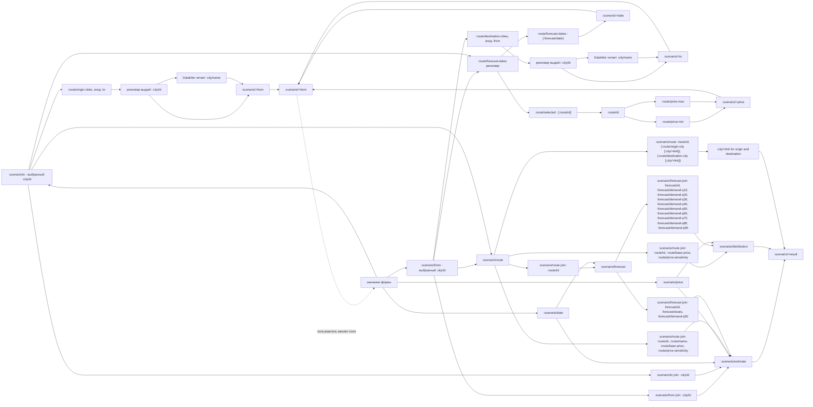
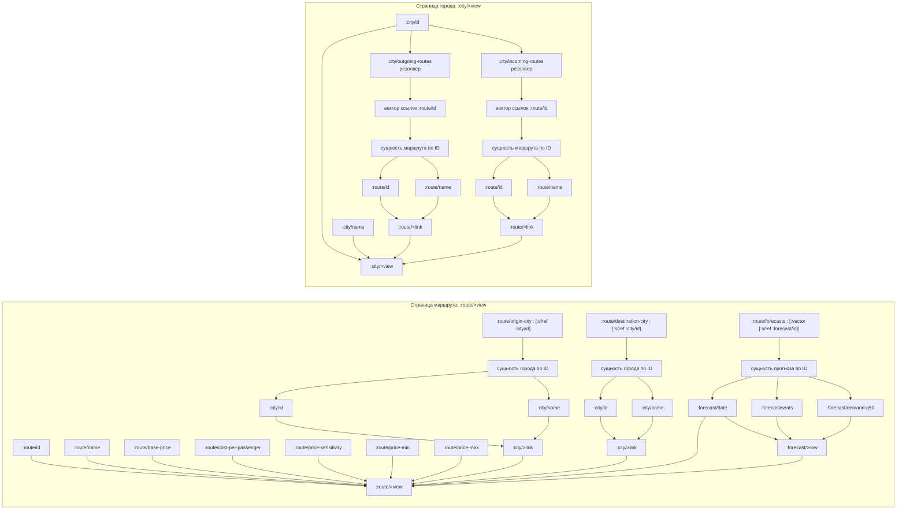

# Решись Авиа

Веб-приложение для оценки спроса и продаж на авиарейсах по заданию «Решись Авиа», блок «Разработка», вариант C. Пользователь выбирает города отправления и назначения, дату вылета и цену билета. Сервер находит прогноз рейса и возвращает число мест, ожидаемые продажи и график спроса.

Демонстрационная версия размещена на [Render](https://reshis-2026-somuthink.onrender.com/). Исходный код опубликован в [GitHub](https://github.com/somuthink/reshis-2026).

## Функции по условиям задания

| Требование | Реализация |
|---|---|
| Веб-страница с серверными расчётами, вариант C | Форма в браузере отправляет запрос через JavaScript-библиотеку Datastar на `POST /eql`. Clojure-сервер выполняет расчёт и возвращает HTML для обновления страницы. |
| Прогноз по маршруту, дате и цене | Выбор строки прогноза из базы и расчёт спроса по медиане с учётом ценовой чувствительности. Продажи ограничены нулём и числом мест. |
| График распределения спроса | Девять квантилей от 0,1 до 0,9 пересчитываются для введённой цены. На графике отмечена вместимость самолёта. |
| Регистрация и авторизация | Страницы `/register` и `/login`, пароли в виде хэшей, сессии и проверка прав на маршруты. |
| Размещение на хостинге | Docker-образ для Render с исходными городами, маршрутами и прогнозами. Ограничения бесплатного размещения описаны ниже. |

Модель машинного обучения не запускается при запросе страницы. Приложение использует готовый результат ML-блока из `my_forecast.csv`; копия для сборки образа хранится в `deploy/my_forecast.csv`. Сведения об ИИ-моделях и инструментах разработки приведены в конце документа.

## Архитектура

В приложении [Scriptorium](https://github.com/somuthink/scriptorium) связывает схемы данных, Pathom-резолверы, Datahike и HTTP. Malli-схема задаёт типы и связи; EQL-запрос описывает нужные ветви графа.

- **[Clojure](https://clojure.org/)** - функциональный Lisp для JVM с неизменяемыми persistent-структурами и REPL.
- **[Malli](https://github.com/metosin/malli)** - схемы как данные Clojure; поддерживает композицию, расширение через registry и пользовательские схемы. Scriptorium собирает их в общий registry и использует для Datahike, Pathom и полей форм.
- **[Pathom 3](https://github.com/wilkerlucio/pathom3) и [EQL](https://github.com/edn-query-language/eql)** - EQL-запросы задают нужные атрибуты и join-ы как EDN. Резолверы объявляют входы и выходы; Pathom строит план вычислений для запрошенного графа. Запросы можно собирать и преобразовывать средствами Clojure; отдельная GraphQL SDL-схема не нужна, но клиенту нужен контракт EQL-атрибутов.
- **[Datahike](https://github.com/replikativ/datahike) и [Datalog](https://en.wikipedia.org/wiki/Datalog)** - база фактов с декларативными запросами: общие переменные связывают условия `:where`, поэтому запрос описывает нужные связи, а не ручной порядок обхода. Приложение ищет маршруты по городам и прогнозы по маршруту и дате. Datahike хранит историю транзакций и поддерживает ветки; здесь используется файловая база, пользовательские ветки не задействованы.
- **[EACL](https://github.com/theronic/eacl)** - ReBAC-модель доступа, вдохновлённая [SpiceDB](https://github.com/authzed/spicedb): отношения «субъект - право - ресурс» хранятся в Datahike, а Pathom проверяет их при выполнении операций. Доступ по умолчанию закрыт.
- **[Hiccup](https://github.com/weavejester/hiccup) и [Chassis](https://github.com/onionpancakes/chassis)** - view-функции возвращают HTML-дерево в виде Clojure-векторов и карт; Chassis сериализует его на сервере.
- **[Datastar](https://data-star.dev/)** - браузер отправляет изменения формы на `/eql`; сервер возвращает SSE с HTML-патчем, который Datastar применяет к DOM. Формы и вычисления остаются на сервере без отдельного SPA-слоя.
- **[Reitit](https://github.com/metosin/reitit) и [Ring](https://github.com/ring-clojure/ring)** - маршруты объявлены данными; Reitit собирает Ring-роутер и подключает EQL endpoint и middleware.
- **[Integrant](https://github.com/weavejester/integrant)** - запускает и останавливает компоненты приложения в заданном порядке.
- **[Babashka](https://babashka.org/) и [`clojure.data.csv`](https://github.com/clojure/data.csv)** - запускают импорт CSV из командной строки и разбирают строки файлов.

## Scriptorium в этом приложении

Malli-описания EDN собираются в реестр схем. Scriptorium преобразует его в схемы сущностей и операции Pathom. При запросе Pathom проходит от требуемого представления страницы к его зависимостям по `:in`, раскрывает ссылки на сущности и получает запрошенные атрибуты. Для полей `:>in` задаёт данные, которые приложение передаёт функции отображения; приложение трактует `:>options` и формирует варианты выбора. Scriptorium не обрабатывает эти настройки списка.

### Форма и расчёт сценария

Запрос страницы требует `:scenario/>form`. Его `:in` перечисляет четыре HTML-поля. Например, поле «Откуда» объявляет источник вариантов через `:>in`, а Pathom-резолвер `:scenario/route` объявляет выбранные идентификаторы городов:

```clojure
[:scenario/from
 {:>label "Откуда"
  :>in [{:route/origin-cities [:city/id :city/name]}]
  :>options {:source :route/origin-cities
             :value :city/id
             :label :city/name}}
 [:s/ref :city/id]]

[:scenario/route
 {:resolve :app.resolvers.scenario/route-selection
  :in [{:scenario/from [:city/id]}
       {:scenario/to [:city/id]}]}
 [:s/ref :route/id]]

[:scenario/>form
 {:resolve :app.views.scenario/form
  :in [:scenario/>from :scenario/>to
       :scenario/>date :scenario/>price]}
 :hiccup]
```

Стрелки показывают поток данных: источник передаёт атрибут резолверу или view. Верхняя часть графа раскрывает параметры формы, нижняя - значения после изменения пользователем и все атрибуты, запрашиваемые вычислениями и `:scenario/>result`.



`:scenario/estimate` получает вложенные `{:scenario/from [:city/id]}` и `{:scenario/to [:city/id]}`. Join `:scenario/route` раскрывается до `:route/id`, `:route/name`, `:route/base-price` и `:route/price-sensitivity`; join `:scenario/forecast` - до `:forecast/id`, `:forecast/seats` и `:forecast/demand-q50`. `:scenario/distribution` запрашивает у join маршрута ID, базовую цену и чувствительность, а у join прогноза - все девять квантилей спроса. `:scenario/>result` соединяет оба расчёта с join маршрута, который раскрывает ссылки на города. Следующий граф показывает, из каких атрибутов собирается каждая ссылка.

### Вложенные страницы маршрута и города

Обработчик маршрута передаёт в Pathom ID из URL и запрашивает `:route/>view`; обработчик города так же запрашивает `:city/>view` по `:city/id`. В `:in` этих view перечислены прямые поля и вложенные join-ы; ниже они показаны до атрибутов, из которых строится каждый Hiccup-узел:

```clojure
[:route/>view
 {:resolve :app.views.route/detail
  :in [:route/id :route/name :route/base-price
       :route/cost-per-passenger :route/price-sensitivity
       :route/price-min :route/price-max
       {:route/origin-city [:city/>link]}
       {:route/destination-city [:city/>link]}
       {:route/forecasts [:forecast/date :forecast/>row]}]}
 :hiccup]

[:city/>link
 {:resolve :app.views.city/link
  :in [:city/id :city/name]}
 :hiccup]

[:route/>link
 {:resolve :app.views.route/link
  :in [:route/id :route/name]}
 :hiccup]

[:forecast/>row
 {:resolve :app.views.forecast/row
  :in [:forecast/date :forecast/seats :forecast/demand-q50]}
 :hiccup]

[:city/>view
 {:resolve :app.views.city/detail
  :in [:city/id :city/name
       {:city/outgoing-routes [:route/id :route/name :route/>link]}
       {:city/incoming-routes [:route/id :route/name :route/>link]}]}
 :hiccup]

[:city/outgoing-routes
 {:resolve :app.resolvers.city/outgoing-routes
  :in [:city/id]}
 [:vector [:s/ref :route/id]]]

[:city/incoming-routes
 {:resolve :app.resolvers.city/incoming-routes
  :in [:city/id]}
 [:vector [:s/ref :route/id]]]
```

В `:route/>view` семь прямых route-полей. Join-ы `:route/origin-city` и `:route/destination-city` следуют по ссылкам `[:s/ref :city/id]`, затем запрашивают `:city/>link`; его `:in` приводит к `:city/id` и `:city/name`. Join `:route/forecasts` проходит по вектору `[:s/ref :forecast/id]`; из каждой forecast-сущности читается `:forecast/date`, а `:forecast/>row` разворачивается в дату, места и медианный спрос.

`:city/>view` запрашивает ID и имя города, а также два маршрутных join-а. Резолверы `:city/outgoing-routes` и `:city/incoming-routes` принимают `:city/id` и возвращают route ID. Каждый результат join раскрывает в `:route/id`, `:route/name` и `:route/>link`; последний строит HTML-ссылку из ID и имени. В графе показаны оба пути до Hiccup-view:



Резолверы прилётов и вылетов фильтруют маршруты по ID города и правам EACL. Остальные листья, например `:city/name` или `:route/name`, Pathom раскрывает по соответствующим схемам и доступным resolver-ам; view-функции получают уже собранные вложенные значения и возвращают Hiccup.

## Данные и расчёт прогноза

В `deploy/my_forecast.csv` находятся 155 записей для пяти маршрутов из Москвы: MOW-AER, MOW-KGD, MOW-LED, MOW-MRV и MOW-OVB. Даты охватывают период с 1 июня по 1 июля 2026 года включительно. Названия городов, базовые цены и коэффициенты чувствительности поступают из `routes.csv`, адрес которого указан в `import.edn`.

`route` и `date` определяют строку прогноза, `seats` задаёт число кресел. Столбцы от `0.1_base_demand` до `0.9_base_demand` содержат девять квантилей спроса при базовой цене. Квантиль 0,5 - медиана. Импорт связывает эти значения с маршрутом в Datahike.

Расчёт в `src/app/resolvers/scenario.clj` использует формулу задания:

```text
спрос = 0.5_base_demand − price_sensitivity × (цена − base_price)
продажи = min(seats, max(0, спрос))
```

Тот же сдвиг по цене применяется к каждому из девяти квантилей. Медиана графика совпадает со спросом до ограничения числом мест. На графике отдельно отмечена вместимость самолёта, а таблица значений доступна программам чтения с экрана.

Список доступных дат зависит от маршрута. Цена задаётся числом или ползунком в пределах тарифа; изменение формы пересчитывает результат с задержкой 300 мс. При отсутствии маршрута или прогноза на выбранную дату сервер возвращает сообщение об ошибке.

Пароли хранятся в виде PBKDF2-SHA256-хэшей. Пользователь видит только разрешённые маршруты и связанные с ними данные; проверку прав выполняет сервер.

## Запуск и импорт данных

Исходный запуск использует Java 25 и Clojure CLI; импорт CSV выполняет Babashka с Datahike pod из `bb.edn`. Зависимость Scriptorium задана локальным путём `../../scriptorium` относительно корня приложения. При размещении приложения в `reshis-2026/app` каталог `scriptorium` находится рядом с `reshis-2026`. Dockerfile создаёт эту структуру при сборке.

### Запуск приложения

Команда запуска среды разработки из корня проекта:

```sh
clojure -M:dev
```

Инициализация компонентов в nREPL, сетевой среде выполнения Clojure:

```clojure
(require 'user)
(integrant.repl/go)
```

При инициализации приложение создаёт схему, открывает `data/routes-db` и запускает HTTP-сервер на порту `3000`.

### Запуск без REPL

Для запуска HTTP-сервера напрямую, без nREPL:

```sh
DATABASE_PATH=/path/to/routes-db PORT=3000 clojure -M -m app.main
```

`DATABASE_PATH` и `PORT` можно не задавать: по умолчанию используются `data/routes-db` и порт `3000`.

`IP` задаёт адрес HTTP-сервера (по умолчанию `0.0.0.0`). Для Alwaysdata подходит тип сайта User program: приложение использует собственный HTTP-сервер, не Tomcat. Платформа передаёт `IP` и `PORT` через окружение.

### Render / Docker

Dockerfile собирает JAR вместе с закреплённой версией Scriptorium. Конфигурация сервиса Render использует среду Docker, ветку `main`, файл `./Dockerfile` и корневой контекст сборки. Проверка доступности обращается к `/login`. Образ содержит команду запуска; отдельные Docker Command и Pre-Deploy Command не требуются. Render передаёт `PORT`; сервер слушает `0.0.0.0`.

Для HTTPS за обратным прокси параметр `PUBLIC_ORIGIN` содержит публичный адрес сайта со схемой, например `https://reshis-2026-somuthink.onrender.com`, без пути и завершающего `/`. Приложение принимает POST-запросы только с точно совпадающим заголовком `Origin`. Cookie сессии получает атрибут `Secure`, который разрешает браузеру передавать его только по HTTPS. Без настройки сравниваются схема и Host входящего запроса; заголовки `X-Forwarded-*` не считаются доверенными.

Локальная сборка и запуск контейнера:

```sh
docker build -t reshis .
docker run --rm -p 10000:10000 reshis
```

Страница входа доступна по адресу `http://localhost:10000/login`.

При сборке приложение создаёт схему пустой базы, затем `bb import_csv.clj` импортирует города, маршруты и прогнозы. Прогнозы берутся из `deploy/my_forecast.csv` (копия `../ml/my_forecast.csv`), маршруты - по URL из `import.edn`. Готовая база включается в образ без локальных пользователей и сценариев.

Render Free не поддерживает постоянные диски: регистрации и другие изменения теряются при перезапуске, развёртывании или засыпании после 15 минут без запросов. После запуска снова доступны исходные импортированные данные.

### Импорт CSV

Настройки импорта хранятся в [`import.edn`](import.edn). Источник маршрутов указан как URL, источник прогнозов - `../ml/my_forecast.csv`. Относительные пути разрешаются от корня приложения.

Импорт требует остановленного приложения и свободной файловой базы. Команда остановки компонентов в nREPL:

```clojure
(integrant.repl/halt)
```

Команда импорта с настройками из `import.edn`:

```sh
bb import_csv.clj
```

Скрипт также принимает два позиционных аргумента - CSV маршрутов и CSV прогнозов. Они заменяют соответствующие значения из `import.edn`:

```sh
bb import_csv.clj routes.csv forecast.csv
```

После импорта компоненты запускаются командой `(integrant.repl/go)` в nREPL. Импорт добавляет записи прогнозов и не заменяет ранее загруженные прогнозы.

Источники собственных файлов задаются через `:routes-source` и `:forecasts-source` в `import.edn` либо двумя позиционными аргументами. Путь `../ml/my_forecast.csv` относится к соседнему каталогу ML-блока; файл для Docker-сборки находится отдельно в `deploy/my_forecast.csv`.

## Проверки и сборка

```sh
clojure -M:test -e "(require 'clojure.test 'app.user-test 'app.mutations.user-test 'app.acl-test 'app.resolvers.scenario-test) (let [r (clojure.test/run-tests 'app.user-test 'app.mutations.user-test 'app.acl-test 'app.resolvers.scenario-test)] (System/exit (+ (:fail r) (:error r))))"
bb -cp .:test -e "(require 'import-csv-test) (let [r (clojure.test/run-tests 'import-csv-test)] (System/exit (+ (:fail r) (:error r))))"
```

Команда сборки JAR - `clojure -T:build uber`. Файл `target/reshis-2026.jar` запускается через `java -jar`; адрес базы и порт задаются переменными `DATABASE_PATH` и `PORT`. Перенос `data/routes-db` требует остановки приложения, чтобы файлы базы оставались согласованными.

## Инструменты разработки

- **Редакторы кода**
  - [Sublime Text](https://www.sublimetext.com/) с [Clojure Sublimed](https://github.com/tonsky/Clojure-Sublimed).
  - [Neovim](https://neovim.io/) с [Conjure](https://github.com/Olical/conjure).
- **[Oh My Pi (OMP)](https://github.com/can1357/oh-my-pi)** - среда работы с ИИ-моделями, инструментами и контекстом проекта.
  - [brepl](https://github.com/licht1stein/brepl) - клиент командной строки для [nREPL](https://github.com/nrepl/nrepl) с исправлением скобок в выражениях.
  - [ast-grep](https://github.com/ast-grep/ast-grep) находит синтаксические структуры; ast-edit меняет Clojure-код структурно, без текстовых замен.
  - **ponytail** - набор правил для небольших изменений без лишних абстракций.
- **Модели** - Luna была основной моделью; GPT-6.1-sol использовался как советник.


